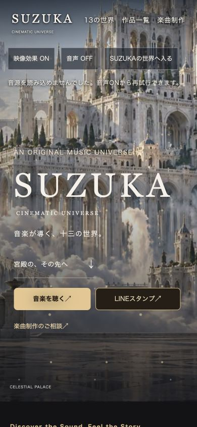

# V6 背景安定化・Deezer対応（PR #15 開発環境限定）

**本番公開HOLD。main・現在公開中のV6／13組／104作品・814ファイルの公開パッケージは変更しません。**

## 調査と比較

本番トップの恒常的な背景消失は再現していません。背景取得のTLS／読み込みタイムアウトと、BABA NOVAで画像到着まで黒く見え、その後復帰する状態を確認しました。報告された端末の原因と同一であるかは未確定です。

画像は既に画面幅別のAVIF／WebPとスマートフォン用の縦長画像があります。トップの縦長AVIFは42,380 bytes、同WebPは86,132 bytes。BABA NOVAの縦長AVIFは111,587 bytes、同WebPは235,894 bytesです。初期背景は既に`loading=eager`・`fetchpriority=high`でした。

| 案 | 利点・影響 | 採否 |
|---|---|---|
| 画像の再圧縮・小型化 | 転送量は減るが、現在の画質を変える。通信確立の失敗は解消しない | 見送り |
| 全13世界・両形式を先読み | 移動時の待機は減る可能性があるが、初回通信が競合する | 見送り |
| 現ページの背景だけを画面幅別に先読み | 既存の画像選択を保ち、HTMLの早い段階で取得を開始できる | 採用 |
| 既存WebPへの代替と制限付き再試行 | AVIF固有の失敗や、一時的な取得失敗から復帰できる | 採用 |
| キャッシュ期間変更・新しいService Worker | 本番ヘッダーや既存の保護音源との影響が広い | 見送り |

## 実装

- トップと13世界の計14ページに、既存画像を参照するAVIF先読みを追加。縦長用と横長用の条件は排他的で、各画面幅で一致する先読みは1件です。全世界の同時取得はしません。
- 元の`picture`、全AVIF／WebP画像、構図、寸法、既存CSS、扉、光・霧・カメラ・花びらの演出は保持しました。159件の背景・演出資産および世界設定は変更しません。
- 約6.5秒待機、または画像取得エラー時に、同じ背景の既存WebPへ切替。WebPのレスポンシブ選択は残し、端末回転やサイズ変更でも対応する画像を選びます。
- WebPも失敗した場合は、同じオリジンの許可された画像URLに`v6-background-retry=1`を付けた1回の再試行だけを行います。再び失敗しても、ページ全体の再読込や無限の通信を起こしません。
- 背景取得不能でも、既存の暗色背景と本文・ボタンを保持します。別の世界の画像や未承認画像へ置換しません。
- オフライン・非表示タブでは再試行を消費せず、復帰後に再開します。画面遷移で取り除かれた画像のタイマーと監視を解除します。
- 追加処理は背景の画像に限定。ジャケット、公式人物画像、音源、認証、既存Service Worker、問い合わせ・GA4・共有の処理には触れません。

約6.5秒はJavaScriptが動作し、対象画像が表示範囲にある時点からの待機時間です。すべての回線での表示時間を保証する数値ではありません。回線全体が不通の場合は両形式とも取得できません。代替WebPはAVIFより大きいため、障害時には追加の転送が発生します。正常時に代替画像を追加取得しないことを自動テストで確認しています。

GitHub Pagesの既存`Cache-Control: max-age=600`は変更していません。画像の再試行だけが別のURLになります。新たなキャッシュ層や音源用Service Workerの変更はありません。

## Deezer：リンク設定と公開ページの到達性を分離

確認日：2026年11月1日（日本時間）。

| 作品 | TuneCoreからの転送 | Deezer公式API | 公開ページ |
|---|---|---|---|
| 榎本魅愛「あなただけに送るHappy Birthday」 | `/to/deezer/2024584` → アルバム1130082751 | 作品名・アーティスト一致 | アルバムURL → Deezer総合トップ |
| 妃みちる「同じ女性へ ～これから母になる人へ～」 | `/to/deezer/2017732` → アルバム1126942941 | 作品名・アーティスト一致 | アルバムURL → Deezer総合トップ |

SUZUKAサイトのURLは公式LinkCore掲載URLと一致しています。TuneCoreも正しいカタログIDを示しています。その先のDeezer公開ページで総合トップへ転送される状態であり、作品の登録自体が存在しないとは判定していません。地域・アカウント等による条件差は未確定です。

- 両曲の**個別Deezerボタンのみ**一時非表示。公式LinkCoreとApple Music・Spotify・YouTube Music・LINE MUSIC・Amazon Music・AWAは維持。
- 他作品のDeezerボタン、元の公式LinkCore台帳は変更しません。
- 記録・非表示条件は`site-content/v6-growth/store-link-policy.json`。公開作品ページへの到達と作品一致を再確認した後、該当する非表示レコードを削除し、再生成・テスト・レビューすると復元できます。日付だけで自動復元しません。

公式証拠：[Happy BirthdayのLinkCore](https://linkco.re/vvasqg5z)、[Deezerカタログ](https://api.deezer.com/album/1130082751)、[同じ女性へのLinkCore](https://linkco.re/aU8rN04N)、[Deezerカタログ](https://api.deezer.com/album/1126942941)。

## 検証

| 項目 | 結果 |
|---|---|
| 候補ビルド | 863ファイル、13組・109作品、公開予定1件 |
| 保護・境界・再現性・内部リンク・URL・SEOテスト | 13件合格 |
| 背景復帰の自動テスト | 7シナリオ合格 |
| 既存の保護音源／第13世界／画像比率 | 11件／7件／3件合格 |
| 背景・画面表示 | トップ＋13世界＋主要5ページ×390・768・1440px、57条件で背景読み込み・横はみ出し・可視画像欠損を検査 |
| ブラウザーの障害試験 | AVIF HTTP 503→WebP表示、WebP初回503→1回の再試行で表示、AVIF 10秒遅延→WebP表示、両形式503→再試行停止・導線保持 |
| ゲート・扉 | 既存扉のアニメーションと画像を確認し、ASTERIAへ移動後の背景を確認 |
| LISTEN | 390pxでゲートから移動。最新2曲の個別ボタンは6サービス＋LinkCore、Deezerなし |
| LINEスタンプ | 両購入先の正式URL・商品名を確認。ECLYPSEはCOMING SOON・購入リンク0件 |
| MUSIC PRODUCTION | ページ移動、既存スクリプト、件名・本文付き相談メールリンクを確認。実送信は実施しない |
| GA4 | 3区分イベント・重複防止・個人情報除外・ローカル送信抑止のテスト合格。管理画面の実受信は未確認 |
| 公開URL／404 | ローカル381 URLが200。未公開作品・開発スクリプト・音源パス等4条件が404 |
| JSON-LD／サイトマップ3種 | 387ブロック、エラー0。既存URLを保持 |
| 公開資産・作品・禁止音源 | 承認済み814ファイルと既存104作品の保護、13組・109作品、静的音源混入なしを確認 |

記録：[画面・導線・障害試験](v6-growth-review/stability-browser-qa.json)、[検証集計](v6-growth-review/stability-verification.json)。

画面中の音源読み込みエラーは、ローカル環境での保護音源アクセスに関する既知の未確認項目です。背景画像の復帰試験と音源再生の合否は分けています。

## 残る確認と公開境界

- iPhone実機・実回線での初回表示、端末回転、Safariの省電力設定での再確認。
- 実際の音源聴取、保護音源の再生待機、GA4管理画面の実受信、メールアプリからの実送信。
- 今回の背景対策は画像取得の復帰を補うもので、通信障害全般を解消するものではありません。実回線での改善率・表示時間の短縮量は未測定です。
- 現在の本番にはこの処理もDeezer非表示も反映されません。候補の公開パッケージ採用・mainマージ・本番公開には別途承認が必要です。
- 変更は専用開発環境とPR #15に限定し、本番HOLDを維持します。
