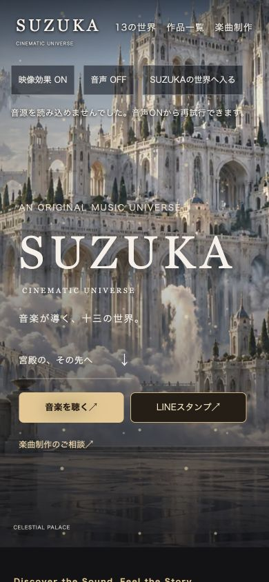
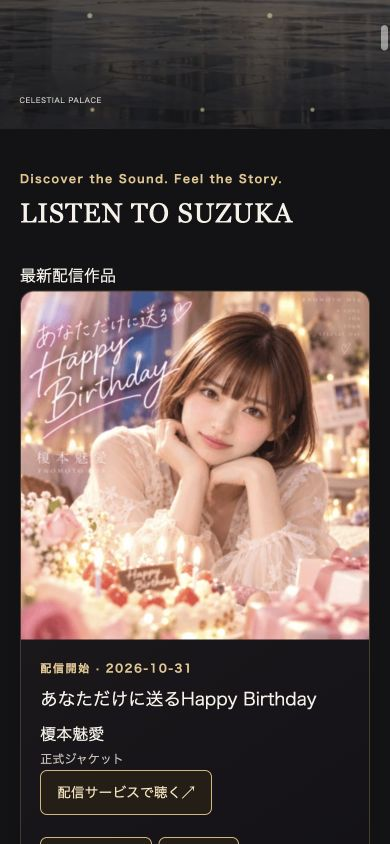
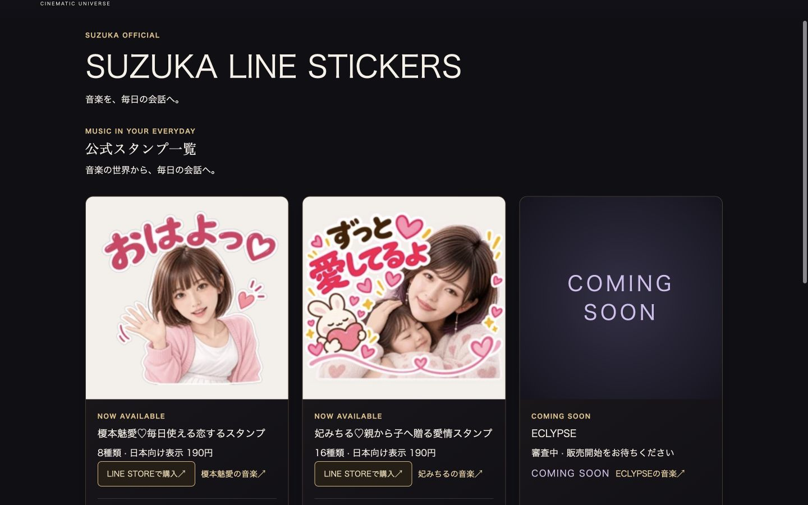

# SUZUKA V6 音楽配信・LINEスタンプ強化 実装報告

状態：**Draftレビュー用。マージ・デプロイ・本番公開はHOLD。**

## 実装結果

| 項目 | 公開中の基準版 | 今回の候補版 |
|---|---:|---:|
| アーティスト／世界 | 13 | 13（同一設定を保持） |
| 公開作品 | 104 | 109（5件追加） |
| 今回管理する公開予定 | — | LAST IGNITION 1件 |
| 公開パッケージ内ファイル | 814 | 862 |
| サイトマップ | 371 URL | 381 URL |
| 削除した既存公開パス | — | 0 |

基準：GitHub main `39aebc4e116b09823dc2567dd8f7e6433312fb12`。
公開パッケージの基準ダイジェスト：
`36477d62f8bbaac84bef7590d6e24a2d9d8be4fa7f3c9315f772da8631f05df7`。

`public-release/` と従来の104作品の生成元は変更していません。
新しい生成処理は、この承認済みパッケージに追加データを適用して、リポジトリ外のプレビューを作ります。
**今回のPRは公開パッケージの切替を行いません。** 公開には候補の正式採用と、別途の明示的な承認が必要です。

## 追加・更新した公式情報

確認日時：2026年11月1日 13:07（日本時間）。公開ページのGET取得のみを使用し、YouTube API更新・認証変更・Studio操作は行っていません。

| 作品 | 区分 | 日付（日本時間） |
|---|---|---|
| 妃みちる「同じ女性へ 〜これから母になる人へ〜」 | ストリーミング配信作品追加 | 配信開始 2026-10-27（時刻未確認） |
| ASTERIA「REDLINE HEARTBEAT」 | Official Audio追加 | YouTube公開 2026-10-28 20:00:08 |
| ASTERIA「OUTRUN THE NIGHT！」 | 公式音源追加 | YouTube公開 2026-10-28 20:00:11 |
| ASTERIA「FIVE GEARS // ONE SKY」 | Official Audio追加 | YouTube公開 2026-10-31 20:00:07 |
| ASTERIA「MIDNIGHT IGNITION」 | Official Music Video追加 | YouTube公開 2026-10-31 20:00:08 |
| ASTERIA「LAST IGNITION」 | 公開予定・公開済み集計から除外 | 2026-11-01 20:00予定。確認時はLIVE_STREAM_OFFLINE |
| 榎本魅愛「あなただけに送るHappy Birthday」 | 配信中へ更新・正式ジャケット追加 | 作品公開10月25日／配信開始10月31日を分離 |

「同じ女性へ」と「Happy Birthday」は公式LinkCoreと日本向けApple Musicを照合しました。
ASTERIAの新作に、未確認のストリーミング配信情報・歌詞・制作クレジットは追加していません。

Shorts6件とnote記事4件を追加しました。妃みちるのスタンプ発売Shortsは商品に関連付け、楽曲作品数には含めません。
LAST IGNITIONは予定データ・スケジュール・ASTERIAページで管理し、公開済みページ、MusicRecording、VideoObject、サイトマップへ出しません。
カレンダーは日付によって分類を移動しますが、公開済みへの昇格は行いません。

## LISTEN TO SUZUKA

- ゲート内に「音楽を聴く」「LINEスタンプ」「楽曲制作のご相談」を配置。
- ゲート直後に「LISTEN TO SUZUKA / Discover the Sound. Feel the Story.」を設置。
- 最新配信6作品、運営者選定の注目3作品、配信作品が確認できたアーティストへの導線を掲載。
- 公式LinkCoreを主要ボタンにし、掲載を確認できたストアのみ個別表示。
- 楽曲ページ、アーティストページ、13世界の作品欄も同期。

注目作品は人気順位・売上順位ではありません。LinkCoreのストア掲載確認と、会員向け実再生の確認は区別しています。

## LINEスタンプ

| 商品 | 状態 | 点数 | 日本向け確認時価格 | 購入導線 |
|---|---|---:|---:|---|
| 榎本魅愛♡毎日使える恋するスタンプ | 販売中 | 8 | 190円 | [正式LINE STORE](https://store.line.me/stickershop/product/37544868/ja) |
| 妃みちる♡親から子へ贈る愛情スタンプ | 販売中 | 16 | 190円 | [正式LINE STORE](https://store.line.me/stickershop/product/37581772/ja) |
| ECLYPSE | 審査中・ユーザー承認情報 | 未確認 | 非表示 | 非表示／COMING SOON |

一覧ページ、メイン画像、全24点のプレビュー、アーティストへのリンクを実装。
販売中状態、正式URL、画像、点数、価格、確認日時がそろった商品だけに購入ボタンを出します。
今後は商品台帳と画像データの変更で切り替えられます。

## MUSIC PRODUCTION・共有・計測

既存ページ、メール宛先、件名・本文の入力補助、メールアドレスコピーの実装を保持。
ゲートとLISTEN付近からの案内を追加し、制作依頼ページの世界数表示を13に合わせました。

既存のX・LINE・端末共有・URLコピーを保持し、Facebookを追加しました。
既存の関連リンク欄がある楽曲ページでは、その欄を残して共有ボタンを追加します。
共有先URLにはcanonicalを使い、検索条件やUTMを含めません。

| GA4イベント | 識別内容 |
|---|---|
| `streaming_click` | 楽曲・アーティスト・サービス・掲載箇所 |
| `line_sticker_click` | 商品・アーティスト・掲載箇所 |
| `music_production_click` | `visit`＝案内ページへ移動／`consultation`＝相談メール導線 |

対象クリックは既存の汎用クリック処理へ渡さず、スクリプトの重複読込も防ぎます。
GA4標準の外部クリック等を上記イベントに合算せず、KPIは上記イベント名を基準に集計します。
メールアドレス・本文・自由入力・外部URL全文は新イベントへ送りません。
ローカル候補版から本番GA4へページ閲覧を送らないよう、既存タグを正式オリジンに限定しました。
クリックは実売上・実再生・問い合わせ送信完了を意味しません。

## 検証結果

| 検査 | 結果 |
|---|---|
| 既存workflow検査 | 54項目合格 |
| 今回の保護・境界・再現性テスト | 11件合格 |
| 既存の保護音源・第13世界・画像比率テスト | 合格 |
| 新イベントの重複・個人情報除外・GA4無効時 | 合格 |
| 内部ファイル参照・ページ内アンカー | 候補385 HTMLで欠損なし |
| 公開URL HTTP検査 | ローカル381 URLすべて200 |
| 存在しないURL・未公開作品・開発スクリプト・音源パス | 4条件すべて404 |
| JSON-LD | 387ブロック、日付・構文・未公開動画混入のエラー0 |
| 既存チャンネル移行履歴 | 36件保持、非公開動画への有効リンク0 |
| sitemap／画像sitemap／動画sitemap | 合格。既存URLを保持 |
| ブラウザー表示 | 8ページ×390・768・1440px＝24条件、横はみ出し・可視画像欠損なし |
| ブラウザーconsole | 検査時の警告・エラーなし |
| 配信・販売先 | 主要LinkCore2件、Apple Music2件、LINE STORE2件のHTTP 200を確認 |
| 元の公開パッケージ | 814ファイル・基準ダイジェスト一致 |
| Terminal作業の未コミット36件 | 状態・ファイル内容のハッシュが開始時と一致 |

GA4管理画面の実受信、実売上、会員向け再生、実音聴取、iPhone実機での操作は今回の合格範囲に含めません。
既知の保護音源の再生待ち時間を解消した変更ではありません。

証跡：[検証集計](v6-growth-review/verification-summary.json)、[ブラウザー24条件](v6-growth-review/browser-qa.json)。

## 変更ファイルと変更箇所

| ファイル | 役割 |
|---|---|
| `scripts/build_v6_growth_preview.py` | 固定した公開版＋追加データから候補を生成。公開・ステージ機能なし |
| `scripts/collect_v6_growth_sources.py` | 公式の公開情報を取得。既存の確定データを上書きしない |
| `site-content/v6-growth/verified-sources.json` | 作品、予定、Shorts、NEWS、ストア、商品、画像の確認済み台帳 |
| `site-content/v6-growth/images/` | 公式画像36点の表示用WebP。元の既存画像は変更なし |
| `site-content/v6-growth/v6-growth.css` | 今回追加部分のデザイン |
| `site-content/v6-growth/analytics-extension.js` | 3区分のクリック計測 |
| `scripts/test_v6_growth_preview.py` | 原本保護、日付、公開状態、販売条件、リンク、再現性の検査 |
| `scripts/test_v6_growth_analytics.cjs` | 重複計測と個人情報除外の検査 |
| `scripts/check_v6_growth_http.py` | 一時的なローカルHTTPサーバーで200／404を検査 |
| `scripts/audit_channel_migration.py` | 従来104作品の厳密検査を保持し、固定基準の109作品候補を明示オプションで検査 |
| `.github/workflows/pages.yml` | 候補の検査を追加。既存の公開パッケージ・デプロイ先・条件は変更なし |
| `docs/v6-growth-review/` | 確認画像と検証記録 |

## ローカル確認方法

Macでこのブランチの作業フォルダを開き、次を実行します。Python 3.12＋`requirements-build.txt`の依存関係、Node.js 24、基準コミットを含むGit履歴が必要です。

```sh
python3 -B scripts/build_v6_growth_preview.py --output /private/tmp/suzuka-v6-growth-review/site
python3 -B scripts/test_v6_growth_preview.py
node scripts/test_v6_growth_analytics.cjs /private/tmp/suzuka-v6-growth-review/site
python3 -B scripts/check_v6_growth_http.py --root /private/tmp/suzuka-v6-growth-review/site
python3 -B -m http.server 8766 --bind 127.0.0.1 --directory /private/tmp/suzuka-v6-growth-review/site
```

ブラウザーで `http://127.0.0.1:8766/` を開きます。停止はターミナルでControl＋Cです。
同じポートが使用中の場合は8767等へ変更してください。
WindowsではPythonコマンドを`py -3.12`へ替え、出力先にリポジトリ外の一時フォルダを指定します。Windows実機での実行確認は未実施です。

出力先に別内容がある場合は上書きせず停止します。データを変更した場合は、新しい出力先で生成してください。
作品追加・価格・販売状態は台帳、レイアウトはCSS、注目作品の選定はビルダーの`featured`を変更します。
ECLYPSEの販売開始は正式販売情報の確認後に台帳・画像を更新し、テストと再レビューを行います。
LAST IGNITIONは公式の公開状態・日時・動画種別を確認してから、別途公開済みデータへ移行してください。

## 本番公開前に必要なこと

1. このDraft PRの内容と実際の画面を確認する。
2. 公開直前に配信・商品・LAST IGNITIONの状態を再確認する。
3. iPhone実機、実音聴取、問い合わせメールアプリ、GA4実受信を確認する。
4. 別途、候補を正式な公開パッケージとして採用する変更をレビューする。
5. ユーザーの明示的なマージ・公開承認を得る。

**今回の作業では、mainへのマージ、Pagesのデプロイ、本番公開は行いません。**

## 確認画像

### スマートフォンのゲート



### スマートフォンのLISTEN



### PCのLINEスタンプ一覧


