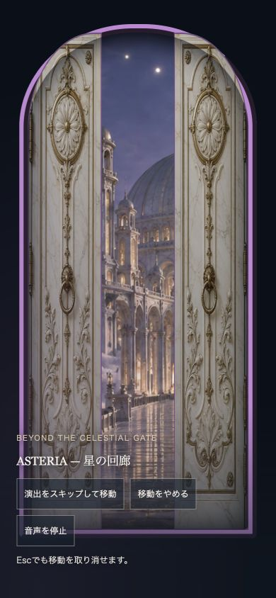
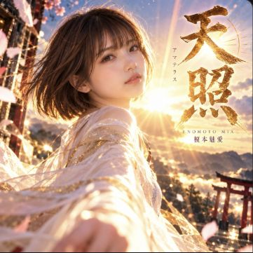

# SUZUKA V6 高速化改善報告（第2段階）

2026-11-02追記：検証済み内容の正式パッケージ採用は[公開候補の準備記録](v6-performance-release-candidate-20261102.md)を参照してください。以下の測定・画像は2026-11-01の保存済み証跡です。Chromeの連続・並列起動とクラッシュ後の自動再試行は禁止し、今回の準備では追加起動していません。

実装・比較検証・Draft PRまで。本番公開はHOLD。
専用worktree：`suzuka-v6-performance-20261101`、ブランチ：`perf/v6-image-loading-20261101`。
最新mainを再取得し、基準の`71ea73944d72fadef5d186a5346a65f1a1609511`と一致した状態から作成しました。

## 実装した改善

- トップと榎本魅愛の世界ページにある「天照」カードに、既存320px・640px WebPと原本1254px PNGのsrcsetを追加。元のsrc URL、1254×1254の比率、alt、loading=lazy、decoding=asyncを保持しました。
- 原本PNG（2,515,697 B）、既存の全画像、作品の高解像度ページは変更・削除しません。DPR=1のカードでは640px WebP（104,430 B）を選択し、DPR=2の1440px検査では原本PNGを選択しました。高精細表示では削減量が同じになるとは保証しません。
- アーティスト一覧、榎本魅愛の従来型ページ、Happy Birthdayの3ページだけ、CSSを元の順序・バイト列のまま統合。未使用ルールの削除・minify・テンプレート変更はしていません。新CSSは同じassetsディレクトリに内容ハッシュ付きの名前で追加し、相対url()とキャッシュ更新を維持します。
- 元のCSS URLをすべて残します。social.cssは既存JSの重複判定が利用するため独立したリンクを維持。統合対象CSSの旧preloadだけを除き、背景画像preloadには触れません。

初期画像の分類：トップはヒーロー1枚をeager/highで優先、他28枚はnative lazy、13世界のtemplateは不活性のままです。独自の遅延ローダーやGA4遅延、音源処理の変更は採用していません。既存lazy指定のまま大きいカード画像を適正選択する範囲に留め、#listenやスクロール直後の空白リスクを増やしていません。

## 測定方法と限界

6ページ × モバイル／PC × 改善前後 × 各3回＝72回。順番はA→B、B→A、A→Bと交互にし、中央値と範囲を保存。ブラウザーが終了した1試行だけを補い、有効72回はエラー・読み込み上限警告0、未完了画像0です。別に高DPR確認を1回実施しました。

Lighthouse 13.6.0、HeadlessChrome 156、cold browser cache、simulate throttling。モバイル412×823／DPR1.75／CPU4倍、PC1350×940／DPR1。前後で設定・ブラウザー版を自動照合しています。HTTP/1.1の同一loopbackサーバー、同じgzip・Cache-Control:max-age=600を使用。全画面スクリーンショット収集は双方とも無効、負荷試験中の保護音源リクエストは双方同条件で遮断しました。表示品質は別途ブラウザーで確認しました。

**非公開候補の比較なので、前回Google PSIの78／99と今回のローカルスコアを直接比較しません。78→96という改善ではありません。** 本番はHTTP/2であり、実回線やGA4スクリプトもあるため、以下は本番の改善幅の保証ではありません。localhostでは元のoriginゲートによりGA4は送信されません。

## モバイル改善前後（各3回の中央値）

| ページ | スコア | LCP秒 | FCP秒 | CLS | Speed Index秒 |
|---|---|---|---|---|---|
| トップ | 96 → 96 | 2.704 → 2.705 | 1.118 → 1.118 | 0.0087 → 0.0087 | 1.121 → 1.118 |
| アーティスト一覧 | 85 → 86 | 4.358 → 4.203 | 1.206 → 0.903 | 0.0000 → 0.0000 | 1.206 → 0.903 |
| 榎本魅愛・従来型 | 81 → 83 | 5.114 → 4.807 | 1.361 → 1.057 | 0.0000 → 0.0000 | 1.361 → 1.057 |
| Happy Birthday | 81 → 83 | 5.112 → 4.803 | 1.209 → 1.053 | 0.0000 → 0.0000 | 1.209 → 1.053 |
| 榎本魅愛・世界 | 93 → 94 | 3.154 → 3.155 | 1.115 → 1.115 | 0.0087 → 0.0026 | 1.115 → 1.115 |
| MUSIC PRODUCTION | 100 → 100 | 0.903 → 0.903 | 0.903 → 0.903 | 0.0000 → 0.0000 | 0.903 → 0.903 |

| ページ | 転送量KiB | 全要求数 | CSS要求数 | JS処理ms | 背景取得ms | 最長画像取得ms |
|---|---|---|---|---|---|---|
| トップ | 609.0 → 609.1 | 14 → 14 | 3 → 3 | 18.92 → 17.78 | 4.28 → 3.16 | 19.22 → 23.54 |
| アーティスト一覧 | 816.0 → 808.4 | 30 → 20 | 12 → 2 | 18.46 → 18.60 | 4.58 → 3.58 | 8.42 → 5.07 |
| 榎本魅愛・従来型 | 771.6 → 761.6 | 34 → 20 | 16 → 2 | 22.19 → 20.90 | 5.32 → 4.44 | 15.93 → 5.06 |
| Happy Birthday | 1,207.0 → 1,198.0 | 31 → 19 | 14 → 2 | 17.34 → 16.95 | 3.56 → 3.26 | 11.06 → 4.66 |
| 榎本魅愛・世界 | 974.0 → 974.1 | 14 → 14 | 2 → 2 | 19.38 → 19.30 | 2.86 → 3.37 | 18.57 → 20.14 |
| MUSIC PRODUCTION | 96.1 → 96.1 | 6 → 6 | 3 → 3 | 11.16 → 11.70 | 0.00 → 0.00 | 0.00 → 0.00 |

画像取得時間はローカルの実ネットワーク記録で、携帯回線の時間ではありません。LCP/FCP/SIはLighthouseのシミュレーション値。JSの0msは監査の集計値であり、JSが実行されない意味ではありません。

## PC改善前後（各3回の中央値）

| ページ | スコア | LCP秒 | FCP秒 | CLS | Speed Index秒 |
|---|---|---|---|---|---|
| トップ | 100 → 100 | 0.288 → 0.300 | 0.288 → 0.300 | 0.0062 → 0.0062 | 0.288 → 0.300 |
| アーティスト一覧 | 99 → 99 | 1.026 → 0.923 | 0.306 → 0.243 | 0.0000 → 0.0000 | 0.306 → 0.243 |
| 榎本魅愛・従来型 | 99 → 99 | 0.929 → 0.842 | 0.369 → 0.282 | 0.0000 → 0.0000 | 0.369 → 0.282 |
| Happy Birthday | 99 → 99 | 0.948 → 0.902 | 0.328 → 0.282 | 0.0000 → 0.0000 | 0.328 → 0.282 |
| 榎本魅愛・世界 | 98 → 98 | 1.105 → 1.106 | 0.303 → 0.303 | 0.0047 → 0.0047 | 0.303 → 0.303 |
| MUSIC PRODUCTION | 100 → 100 | 0.245 → 0.244 | 0.245 → 0.244 | 0.0000 → 0.0000 | 0.245 → 0.244 |

| ページ | 転送量KiB | 全要求数 | CSS要求数 | JS処理ms | 背景取得ms | 最長画像取得ms |
|---|---|---|---|---|---|---|
| トップ | 3,414.5 → 1,059.5 | 17 → 17 | 3 → 3 | 0.00 → 0.00 | 6.25 → 4.90 | 52.91 → 24.08 |
| アーティスト一覧 | 1,282.3 → 1,274.6 | 31 → 21 | 12 → 2 | 0.00 → 2.24 | 5.13 → 3.27 | 6.82 → 6.90 |
| 榎本魅愛・従来型 | 687.5 → 677.5 | 33 → 19 | 16 → 2 | 2.53 → 2.70 | 5.95 → 3.59 | 11.57 → 3.70 |
| Happy Birthday | 1,165.4 → 1,156.4 | 30 → 18 | 14 → 2 | 2.03 → 1.96 | 4.22 → 3.33 | 8.80 → 4.87 |
| 榎本魅愛・世界 | 4,841.8 → 2,487.1 | 25 → 25 | 2 → 2 | 0.00 → 0.00 | 3.01 → 3.02 | 118.19 → 26.16 |
| MUSIC PRODUCTION | 96.1 → 96.1 | 6 → 6 | 3 → 3 | 0.00 → 0.00 | 0.00 → 0.00 | 0.00 → 0.00 |

画像取得時間はローカルの実ネットワーク記録で、携帯回線の時間ではありません。LCP/FCP/SIはLighthouseのシミュレーション値。JSの0msは監査の集計値であり、JSが実行されない意味ではありません。

## 改善の判定

- PCトップ：転送量中央値3,496,431 B → 1,084,900 B（約69%減）。リクエスト数17件は同じ。LCPは0.288秒→0.300秒、スコア100→100で、初期描画の改善とは判定しません。画像の転送負担削減を採用理由とします。
- PCの榎本魅愛世界ページ：4,958,040 B → 2,546,797 B。LCPは約1.105秒で同程度。
- モバイルの最大LCP改善は最新楽曲ページと榎本魅愛従来型で、どちらも約0.31秒（約6%）です。FCPも約0.16〜0.30秒短縮。CSSの取得要求は一覧12→2、従来型16→2、最新楽曲14→2（動的social.cssを含む）でした。
- 一覧のモバイルLCP中央値は4.358秒→4.203秒。ただし改善後の3回の範囲は4.203〜4.728秒で、1回は改善前より遅い値です。FCP・要求数の改善は確認しましたが、LCPのばらつきは残ります。
- トップのモバイル、榎本魅愛の世界ページの初期描画、変更していないMUSIC PRODUCTIONには明確な速度改善がありません。スコアやCLSの小さな揺れを、この実装の効果とは扱いません。
- CSS対象のCLSは前後とも0。V6のCLS変動は未変更の実行状態・タイミングも含む観測値であり、画像差替えによる改善を断定しません。

## 表示品質・機能への影響

- CSS対象3ページ×390／768／1440pxの9比較で、合計2,001要素の位置・寸法・文字・色・画像fitの設定が前後一致。横はみ出し0。全CSSはrender-blockingを維持し、途中の無装飾表示を導入していません。実機・極端な低速時のFOUCを絶対に保証するものではありません。
- トップ＋13世界×3幅＝42条件、LINE・制作相談・作品一覧×3幅＝9条件、計51条件で背景／可視画像の欠損・横はみ出し0。
- 390pxのCELESTIAL GATEからLISTENへ移動し、表示されたカード画像の読み込みを確認。カードをスクロール表示し、原本PNGと640px WebPが同じ約360.7×360.7 CSS pxで表示されることを確認しました。
- 361×361pxのカード撮影比較で、構図・色・文字の可読性に大きな差は見られません。JPEG撮影比較の平均チャネル差2.68／255、PSNR35.79dBは参考値で、原本とのピクセル一致を意味しません。1254px原本は変更0です。
- 390pxで扉の左右の3D回転、世界の出現、キャンセル、ASTERIAへの到達を確認。CSS統合後の一覧でも扉が開き、榎本魅愛ページへ移動しました。背景・扉・アニメーション・音源JSそのものの変更は0です。
- LINE購入リンク2件、ECLYPSEのCOMING SOON／購入ボタンなし、MUSIC PRODUCTIONのメール宛先・件名・本文テンプレートを確認。メールは送信していません。

撮影したゲートにある音源エラー表示は、localhostでの保護音源アクセスによる前後共通の制約です。候補の実音再生は確認していません。音源処理の変更は0です。

## GA4への影響

GA4ローダー・analytics.js・データ属性・リンク先・登録順序は変更0。生成候補に対する既存のVMテストで3イベント区分、visit/contact区分、重複登録防止、個人情報除外が合格しました。模擬発火と、GA4管理画面の実受信は区別します。候補は未公開でlocalhost送信も抑止されるため、候補版の実受信は未確認です。既存本番の確認済み3イベントについて設定変更や不要なクリックをしていません。

## 保護・自動検証

- 本番public-releaseの4ファイル（descriptor＋3分割archive）を変更0。基準863ファイルのパスと、変更を許可していないすべてのバイト列を保持。候補は3 CSS追加により866ファイルです。
- 13アーティスト・109作品、公開予定LAST IGNITION除外、歌詞、SNS共有、購入・相談、背景・公式画像・音源処理を保護。
- 構造化データ387ブロック、VideoObject224件：エラー0。サイトマップ381 URL、画像サイトマップ328 URL／2,107画像、動画132 URL／225動画：合格。
- 381 URLのHTTP 200、4件の想定404：合格。全HTMLの内部参照・アンカー検査、公開禁止音源の拡張子／内容検査とprivate-audio gateを実施。
- 新規回帰テスト10件、GA4模擬検証、背景回復7シナリオ：合格。GitHub Actionsには候補の生成・同じ検査を追加しています。CIの最新結果はDraft PRのチェック欄を参照してください。
- Terminalの未コミット36件は変更しません。状態・内容の集約ハッシュで前後確認します。既存開発コピーやV5保存版を削除・整理していません。

## 変更ファイルと公開方式

リポジトリの実装は`build_v6_performance_preview.py`、`test_v6_performance_preview.py`、`summarize_v6_performance.py`、`serve_v6_performance_review.py`、`.github/workflows/pages.yml`と本報告・証跡です。実際の候補HTMLはトップ、榎本魅愛世界、一覧、榎本魅愛従来型、Happy Birthdayの5ページ。追加CSSは3本です。

2026-11-01時点ではレビュー候補の生成・検証まででした。2026-11-02のユーザー承認により、検証済み内容を正式パッケージへ採用しました（詳細は追記記録）。Pagesのstage/upload/deploy条件は維持し、候補は別途の公開承認がない限りstageを拒否します。Draft PRのまま、本番公開はHOLDです。

## 未確認事項と公開推奨判定

本番HTTP/2・実回線での改善幅、公開後PSIスコア、実iPhone/Android、INP、実機の発熱、実音聴取、音声ON継続時の性能、候補版GA4実受信、メール実送信は未確認です。前段のGoogle測定環境における音源セッション403の条件差は、この作業で変更・解消していません。

判定：**転送量削減と従来型ページの限定的な改善として、公開候補にする価値があります。トップのモバイルLCP改善目標は未達です。Draftを維持し、本番公開はHOLD。** 画質・演出を落としていないことを確認したうえで、正式パッケージ採用と別途の公開承認へ進む候補です。

## 再現手順

Python 3.12＋requirements-build.txtのPillow、Node.jsとLighthouse 13.6.0を使用します。原本・開発コピーの削除は不要です。

```sh
python3 -B scripts/build_v6_performance_preview.py --variant baseline --output /private/tmp/suzuka-v6-speed-phase2/baseline
python3 -B scripts/build_v6_performance_preview.py --variant images --output /private/tmp/suzuka-v6-speed-phase2/images
python3 -B scripts/build_v6_performance_preview.py --output /private/tmp/suzuka-v6-speed-phase2/combined
python3 scripts/serve_v6_performance_review.py --root /private/tmp/suzuka-v6-speed-phase2
```

測定は保存済み72件を再利用します。Chromeの起動問題が確認されたため、以前の連続Lighthouse測定コマンドは実行しません。通常起動の安定と既存ブラウザー再利用の可否を確認した後でも、追加計測は単一試行・初回異常で停止とし、自動再試行しません。以下はブラウザーを起動しない既存データの集計だけです。

```sh
python3 -B scripts/summarize_v6_performance.py --root /private/tmp/suzuka-v6-speed-phase2 --output /private/tmp/suzuka-v6-speed-phase2/comparison.json
```

生のLighthouse JSONはローカルの`/private/tmp/suzuka-v6-speed-phase2/mobile`と`desktop`。[比較データ](performance-20261101/comparison.json)、[ブラウザー検証](performance-20261101/browser-quality.json)、[高DPR確認](performance-20261101/high-dpr.json)、[画像比較](performance-20261101/card-comparison.json)を本PRに含めています。





